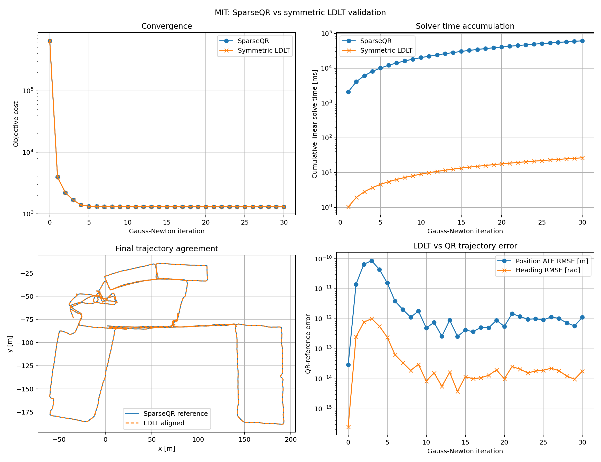
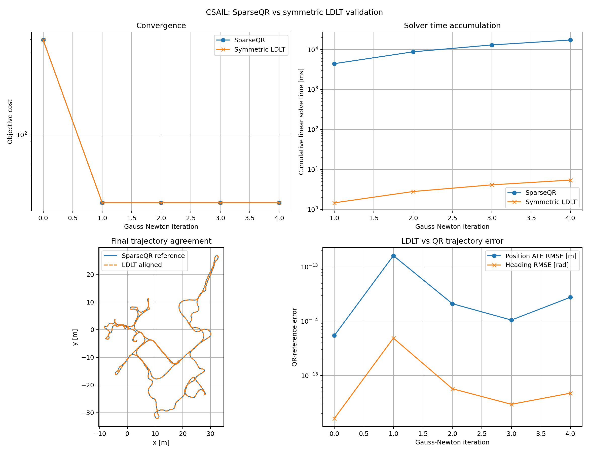

# CORA / SE-Sync SymForce Foundation

A C++ research implementation for reproducing, validating, and profiling the
pose-graph optimization formulations underlying **SE-Sync**, with
**SymForce-generated residuals and Jacobians**, sparse graph assembly, and
nonlinear solver benchmarking.

The project currently focuses on **2D SE(2) pose-graph optimization** and is
being used as a validated numerical foundation for studying:

- exact SE-Sync formulation and translation elimination,
- symbolic residual/Jacobian generation with SymForce,
- sparse graph linearization,
- Gauss--Newton optimization,
- SparseQR versus symmetric sparse LDLT,
- initialization sensitivity and local minima,
- comparison against the official SE-Sync implementation,
- and future work on initialization robustness, structured elimination,
  Schur-complement methods, and certifiable optimization.

> **Important:** This repository does not currently claim to implement the
> complete SE-Sync global solver or CORA. The present goal is to validate each
> formulation and numerical layer independently before introducing a global
> relaxation or additional CORA variables.

---

## 1. Current status

The current implementation now covers the complete path

```text
Relative SE(2) measurements
        |
        v
Direct SE-Sync PGO objective
        |
        +------------------------------+
        |                              |
        v                              v
B1 / B2 / B3 operators          SymForce residual
        |                              |
        v                              v
Explicit quadratic M            Symbolic Jacobian
        |                              |
        v                              v
Translation elimination         Generated C++ kernels
        |                              |
        v                              v
Reduced rotation-only Q         Global sparse assembly
                                       |
                                       v
                                 Gauss--Newton
                                       |
                         +-------------+-------------+
                         |                           |
                         v                           v
                    SparseQR               Gauge-reduced
                                           SimplicialLDLT
                         |                           |
                         +-------------+-------------+
                                       |
                                       v
                            nonlinear validation
                                       |
                                       v
                       official SE-Sync cross-check
```

The formulation, symbolic differentiation, sparse assembly, and two nonlinear
linear-solver backends have been independently validated.

The main open question is no longer whether SparseQR and LDLT solve the same
local Gauss--Newton problem. They do.

The current research question is:

> **How should the optimizer handle poor or missing pose initialization while
> preserving the possibility of recovering and certifying the globally optimal
> SE-Sync solution?**

Chordal initialization is being retained as a practical baseline, while
initialization-robust and certifiable alternatives are being investigated.

---

# 2. Key results

## 2.1 Symbolic residual and Jacobian validation

The SymForce-generated implementation reproduces the handwritten SE-Sync
residual to numerical precision.

```text
Residual equivalence error       = 2.002685474353e-16
Cost equivalence error           = 5.551115123126e-17
Jacobian finite-difference error = 1.654302250742e-10
```

Additional differential checks:

```text
2 J^T r vs finite-difference cost gradient ≈ 4.79e-11
J v vs finite-difference residual derivative ≈ 9.51e-11
```

---

## 2.2 SparseQR versus symmetric LDLT

The nonlinear optimizer was executed with the same:

- objective,
- initialization,
- residuals,
- generated Jacobians,
- line search,
- stopping conditions,
- and state updates.

Only the linear-solver backend was changed.

### Reference backend

```text
Eigen::SparseQR
```

solving

\[
J \Delta x \approx -r.
\]

### Symmetric backend

```text
Eigen::SimplicialLDLT
```

solving the gauge-reduced normal equations

\[
H_r \Delta x_r = -g_r,
\]

with

\[
H_r = J_r^{\top}J_r,
\qquad
g_r = J_r^{\top}r.
\]

The first-pose translation increments are fixed to remove the exact
translation gauge.

---

## 2.3 Nonlinear solver validation figures

The final validation plots combine:

- objective convergence,
- cumulative linear-solver runtime,
- aligned trajectory comparison,
- position ATE,
- and heading error.

<table>
  <tr>
    <th align="center">MIT</th>
    <th align="center">CSAIL</th>
  </tr>
  <tr>
    <td align="center">
      
    </td>
    <td align="center">
      
    </td>
  </tr>
</table>

These figures are solver-equivalence experiments. SparseQR is used as the
numerical reference and is **not** treated as global ground truth.

---

## 2.4 CSAIL nonlinear result

For CSAIL, both solver backends converge to the same solution in four
Gauss--Newton iterations.

```text
Final QR cost       ≈ 31.7037158836249
Final LDLT cost     ≈ 31.7037158836249
Iterations          = 4
Relative cost gap   ≈ 2.24e-15
```

Representative three-run median timings:

```text
SparseQR solve time ≈ 18632.565 ms
LDLT solve time     ≈     5.381 ms

SparseQR wall time  ≈ 18635.963 ms
LDLT wall time      ≈     8.605 ms
```

The corresponding ratios are approximately

```text
linear-solve ratio ≈ 3463x
wall-time ratio    ≈ 2166x
```

These values describe this implementation and benchmark configuration only.
They are not intended as a general comparison between QR and LDLT across all
SLAM systems.

---

## 2.5 MIT local-minimum investigation

Using the supplied MIT `VERTEX_SE2` trajectory as initialization, both
SparseQR and LDLT converge to the same local solution near

```text
F ≈ 1298.03
```

Increasing the iteration cap from 30 to 200 does not resolve the issue.

The optimizer terminates after 69 iterations with

```text
QR final cost        = 1298.03279183363
LDLT final cost      = 1298.03279183363

QR iterations        = 69
LDLT iterations      = 69

QR solve total       ≈ 147450.19 ms
LDLT solve total     ≈     61.90 ms
```

The final QR and LDLT trajectories agree after alignment:

```text
ATE RMSE             ≈ 5.99e-13 m
maximum position gap ≈ 1.62e-12 m
heading RMSE         ≈ 8.87e-15 rad
```

Therefore, the `1298` result is **not caused by the old 30-iteration limit**
and is **not caused by disagreement between the QR and LDLT backends**.

It is an initialization / nonconvex-optimization issue.

---

# 3. Official SE-Sync validation

The official SE-Sync implementation was used as an external reference on the
same MIT graph.

It reports:

```text
poses        = 808
measurements = 827

chordal initial objective ≈ 88.1316

certified final objective ≈ 61.1541
```

The official solver additionally reports:

```text
second-order critical point found
global optimum found
SDP primal and dual objectives agree
duality gap ≈ numerical precision
```

The exported rounded trajectory was evaluated independently using this
repository.

Our direct SE-Sync evaluator gives:

```text
rotation contribution    = 41.0850352038581
translation contribution = 20.0690808879390
total                    = 61.1541160917971
```

The official value and our evaluation agree to approximately

```text
relative error ≈ 4.65e-16
```

The SymForce-generated evaluator produces the same cost.

This provides an external validation of:

- the SE-Sync residual convention,
- measurement loading,
- translation precision conversion,
- rotation precision handling,
- handwritten objective,
- and generated SymForce objective.

---

## 3.1 Our nonlinear solver at the certified solution

The official SE-Sync trajectory was also used as an initialization for the
local Gauss--Newton implementation.

Starting from

```text
F = 61.154116091797107
```

the LDLT iterations were:

```text
iteration 0 : 61.154116091797107
iteration 1 : 61.154115526595191
iteration 2 : 61.154115524704849
iteration 3 : 61.154115524641696
iteration 4 : 61.154115524636858
```

Final comparison:

```text
QR final cost      = 61.1541155246367
LDLT final cost    = 61.1541155246369

QR iterations      = 4
LDLT iterations    = 4

QR solve total     ≈ 8936.441 ms
LDLT solve total   ≈    3.774 ms
```

This establishes that the local SymForce Gauss--Newton pipeline behaves
correctly in the neighborhood of the certified SE-Sync solution.

Combined with the raw-MIT result, the experiment isolates the current problem:

```text
raw MIT initialization
        |
        v
local GN basin near 1298

official certified trajectory
        |
        v
our GN remains near 61.1541
```

---

# 4. Problem formulation

For a relative pose measurement between poses \(i\) and \(j\),

\[
\widetilde{R}_{ij},
\qquad
\widetilde{t}_{ij},
\]

the SE-Sync objective used throughout this repository is

\[
F(R,t)
=
\sum_{(i,j)}
\kappa_{ij}
\left\|
R_j - R_i\widetilde{R}_{ij}
\right\|_F^2
+
\tau_{ij}
\left\|
t_j - t_i - R_i\widetilde{t}_{ij}
\right\|_2^2.
\]

Here:

- \(R_i,R_j \in SO(2)\) are absolute rotations,
- \(t_i,t_j \in \mathbb{R}^2\) are absolute translations,
- \(\widetilde{R}_{ij}\) is the measured relative rotation,
- \(\widetilde{t}_{ij}\) is the measured translation expressed in frame \(i\),
- \(\kappa_{ij}\) is the rotational precision,
- \(\tau_{ij}\) is the isotropic translational precision.

The repository maintains several mathematically equivalent views of this same
objective.

---

# 5. g2o measurement loading

For an `EDGE_SE2` measurement, define the translational information block

\[
\Omega_{t,ij}
=
\begin{bmatrix}
I_{11} & I_{12} \\
I_{12} & I_{22}
\end{bmatrix}.
\]

The SE-Sync isotropic translation precision is loaded as

\[
\tau_{ij}
=
\frac{2}
{\mathrm{tr}\!\left(\Omega_{t,ij}^{-1}\right)}.
\]

For a symmetric \(2\times2\) block this can equivalently be written as

\[
\tau_{ij}
=
\frac{2\,\det(\Omega_{t,ij})}
{\mathrm{tr}(\Omega_{t,ij})}.
\]

The rotation precision is

\[
\kappa_{ij}=I_{33}.
\]

The translation/rotation cross-information entries are intentionally not used
because the implemented objective follows the SE-Sync isotropic precision
model.

---

# 6. Equivalent SE-Sync formulations

## 6.1 Direct residuals

The direct rotation residual is

\[
e^R_{ij}
=
R_j-R_i\widetilde{R}_{ij}.
\]

The direct translation residual is

\[
e^t_{ij}
=
t_j-t_i-R_i\widetilde{t}_{ij}.
\]

The weighted edge objective is

\[
F_{ij}
=
\kappa_{ij}
\left\|e^R_{ij}\right\|_F^2
+
\tau_{ij}
\left\|e^t_{ij}\right\|_2^2.
\]

The handwritten implementation in

```text
src/pgo_cost.cpp
```

is retained as an independent numerical reference.

---

## 6.2 B1 / B2 / B3 residual operators

Let \(r\) denote the column-major vectorization of the stacked rotation
matrices.

The translation residual can be represented as

\[
e_t = B_1t+B_2r,
\]

while the rotation residual is

\[
e_R=B_3r.
\]

Therefore,

\[
F
=
\left\|B_1t+B_2r\right\|_2^2
+
\left\|B_3r\right\|_2^2.
\]

At the edge level,

\[
B_1t
=
\sqrt{\tau_{ij}}
(t_j-t_i),
\]

\[
B_2r
=
-\sqrt{\tau_{ij}}
R_i\widetilde{t}_{ij},
\]

and

\[
B_3r
=
\sqrt{\kappa_{ij}}
\mathrm{vec}
\left(
R_j-R_i\widetilde{R}_{ij}
\right).
\]

The rotation vectorization convention is column-major:

\[
\mathrm{vec}(R)
=
\begin{bmatrix}
R_{00} &
R_{10} &
R_{01} &
R_{11}
\end{bmatrix}^{\top}.
\]

---

## 6.3 Explicit quadratic formulation

With translation variables followed by vectorized rotation blocks, the
objective can also be represented as

\[
F(Y)
=
\mathrm{tr}
\left(
YMY^{\top}
\right).
\]

The quadratic data matrix has block form

\[
M
=
\begin{bmatrix}
L_{\tau} & V \\
V^{\top} & L_{\rho}+\Sigma
\end{bmatrix},
\]

where:

- \(L_{\tau}\) is the translational weighted graph Laplacian,
- \(V\) contains translation/rotation coupling,
- \(\Sigma\) contains translation-measurement quadratic terms,
- \(L_{\rho}\) is the rotational connection Laplacian.

No convex relaxation is introduced here.

This is another representation of the same original PGO objective.

---

# 7. Exact translation elimination

For fixed rotations, the translation variables form a linear least-squares
problem:

\[
t^\star(R)
=
\underset{t}{\arg\min}\;
F(R,t).
\]

Because the cost depends only on relative translation, global translation is
unobservable.

A translation gauge is therefore removed before solving the reduced system.

Let \(A\) be the oriented incidence matrix and

\[
\Omega
=
\mathrm{diag}
(\tau_1,\ldots,\tau_m).
\]

After removing one redundant row from the incidence matrix,

\[
B
=
A_{\mathrm{red}}\Omega^{1/2}.
\]

Define

\[
\Pi
=
I
-
B^{\top}
(BB^{\top})^{-1}
B.
\]

The implementation does **not** explicitly form the matrix inverse. The
corresponding linear system is solved through numerical factorization.

The resulting reduced rotation-only matrix is

\[
Q
=
L_{\rho}
+
T^{\top}
\Omega^{1/2}
\Pi
\Omega^{1/2}
T.
\]

The reduced objective is

\[
F_{\mathrm{red}}(R)
=
\mathrm{tr}
\left(
RQR^{\top}
\right).
\]

The implementation verifies numerically that

\[
F(R,t^\star(R))
=
F_{\mathrm{red}}(R).
\]

Therefore translation elimination does not discard translation-measurement
information. Its optimal contribution remains encoded in \(Q\).

---

# 8. SymForce residual generation

The handwritten SE-Sync residual is reproduced symbolically with SymForce.

For one edge,

\[
r^R_{ij}
=
\sqrt{\kappa_{ij}}
\left(
R_j-R_i\widetilde{R}_{ij}
\right),
\]

and

\[
r^t_{ij}
=
\sqrt{\tau_{ij}}
\left(
t_j-t_i-R_i\widetilde{t}_{ij}
\right).
\]

For

\[
R(\theta)
=
\begin{bmatrix}
\cos\theta & -\sin\theta \\
\sin\theta & \cos\theta
\end{bmatrix},
\]

the complete edge residual is

\[
r_{ij}
=
\begin{bmatrix}
\sqrt{\kappa_{ij}}
\mathrm{vec}
\left(
R_j-R_i\widetilde{R}_{ij}
\right)
\\
\sqrt{\tau_{ij}}
\left(
t_j-t_i-R_i\widetilde{t}_{ij}
\right)
\end{bmatrix}
\in
\mathbb{R}^{6}.
\]

The corresponding local state ordering is

\[
x_{ij}
=
\begin{bmatrix}
\theta_i &
t_{ix} &
t_{iy} &
\theta_j &
t_{jx} &
t_{jy}
\end{bmatrix}^{\top}.
\]

Thus,

\[
J_{ij}
=
\frac{\partial r_{ij}}
{\partial x_{ij}}
\in
\mathbb{R}^{6\times6}.
\]

The SymForce path intentionally reproduces the SE-Sync matrix-difference
rotation residual.

It does **not** replace the objective with a generic Lie-logarithm
`Pose2` residual.

---

# 9. Symbolic derivative structure

Define

\[
J_2
=
\begin{bmatrix}
0 & -1 \\
1 & 0
\end{bmatrix}.
\]

For \(SO(2)\),

\[
\frac{\partial R(\theta)}
{\partial\theta}
=
R(\theta)J_2.
\]

Therefore,

\[
\frac{\partial r^t_{ij}}
{\partial t_i}
=
-\sqrt{\tau_{ij}}I,
\]

\[
\frac{\partial r^t_{ij}}
{\partial t_j}
=
+\sqrt{\tau_{ij}}I,
\]

and

\[
\frac{\partial r^t_{ij}}
{\partial\theta_i}
=
-\sqrt{\tau_{ij}}
R_iJ_2\widetilde{t}_{ij}.
\]

The rotational derivatives are

\[
\frac{\partial r^R_{ij}}
{\partial\theta_i}
=
-\sqrt{\kappa_{ij}}
R_iJ_2\widetilde{R}_{ij},
\]

and

\[
\frac{\partial r^R_{ij}}
{\partial\theta_j}
=
+\sqrt{\kappa_{ij}}
R_jJ_2.
\]

Each edge therefore depends only on two poses, producing a naturally sparse
global Jacobian.

---

# 10. SymForce code-generation pipeline

The symbolic generator is located at

```text
codegen/python/generate_pgo_residuals.py
```

The pipeline is

```text
symbolic SE-Sync residual
        |
        v
symbolic differentiation
        |
        v
common-subexpression elimination
        |
        v
generated Eigen/C++ kernels
        |
        +--> generated/edge_residual.h
        |
        +--> generated/edge_jacobian.h
```

The generated headers are runtime kernels and should not normally be edited
manually.

The generated kernels are wrapped by the C++ project layer before being used
for graph-level linearization and optimization.

---

# 11. Sparse graph linearization

For a graph with \(n\) poses and \(m\) measurements, local edge Jacobians are
scattered into two sparse blocks:

\[
J_c
\in
\mathbb{R}^{6m\times n},
\]

for angular variables, and

\[
J_f
\in
\mathbb{R}^{6m\times2n},
\]

for translation variables.

The complete Jacobian is

\[
J
=
\begin{bmatrix}
J_c & J_f
\end{bmatrix}.
\]

The corresponding normal matrix is

\[
H
=
J^{\top}J
=
\begin{bmatrix}
H_{cc} & H_{cf} \\
H_{fc} & H_{ff}
\end{bmatrix}.
\]

The local-to-global scatter convention is

```text
local col 0 -> theta_i
local col 1 -> t_ix
local col 2 -> t_iy

local col 3 -> theta_j
local col 4 -> t_jx
local col 5 -> t_jy
```

The implementation verifies the exact global translation nullspace:

\[
J_fv_x=0,
\qquad
J_fv_y=0.
\]

---

# 12. Gauss--Newton optimizer

At iteration \(k\),

\[
r(x_k+\Delta x)
\approx
r_k+J_k\Delta x.
\]

The local least-squares problem is

\[
\underset{\Delta x}{\min}
\left\|
r_k+J_k\Delta x
\right\|_2^2.
\]

The implementation uses

\[
g=J^{\top}r,
\qquad
H=J^{\top}J,
\]

and solves

\[
H\Delta x=-g
\]

for the symmetric backend.

The exact objective is

\[
F=r^{\top}r.
\]

Therefore,

\[
\nabla F=2J^{\top}r,
\]

and the Gauss--Newton approximation is

\[
H_{\mathrm{GN}}\approx2J^{\top}J.
\]

The common factor of two cancels from the step equation.

The optimizer includes:

- sparse graph linearization,
- configurable maximum iterations,
- gradient and step termination conditions,
- backtracking line search,
- trajectory update,
- per-iteration timing,
- objective history,
- and export for solver validation.

---

# 13. SparseQR reference solver

The reference path solves

\[
J\Delta x\approx-r
\]

using

```cpp
Eigen::SparseQR<
    Eigen::SparseMatrix<double>,
    Eigen::COLAMDOrdering<int>>
```

This avoids explicitly forming normal equations and is retained as an
independent reference backend.

Profiling showed, however, that generic SparseQR factorization dominates
runtime for the tested graphs.

This should not be interpreted as a general claim about all QR
implementations or about external SLAM libraries.

---

# 14. Symmetric LDLT solver

The symmetric path fixes the first-pose translation increments,

\[
\Delta t_{0x}=0,
\qquad
\Delta t_{0y}=0,
\]

and constructs the reduced normal system

\[
H_r=J_r^{\top}J_r,
\qquad
g_r=J_r^{\top}r.
\]

The step is obtained from

\[
H_r\Delta x_r=-g_r
\]

using

```cpp
Eigen::SimplicialLDLT
```

and then expanded back into the full increment vector.

A known numerical caveat is that normal equations square the condition
number approximately:

\[
\mathrm{cond}(J^{\top}J)
\approx
\mathrm{cond}(J)^2.
\]

For that reason, equivalence with the QR reference is checked numerically
rather than assumed.

---

# 15. Frozen-linearization validation

For a frozen linearization, both solvers are compared through quantities that
remain meaningful in the presence of gauge freedom.

## MIT

Representative result:

```text
J               = 4962 x 2424
QR rank          = 2422
H reduced        = 2422 x 2422
nnz(H reduced)   = 13896

QR total         ≈ 2175.43 ms
LDLT total       ≈    0.824 ms

ratio            ≈ 2641x
```

Both solutions produce essentially the same residual-space prediction:

```text
||J dx_QR + r|| ≈ ||J dx_LDLT + r||

||J(dx_QR - dx_LDLT)|| ≈ 1.14e-11

relative ||H dx + g|| ≈ 2.46e-15
```

## CSAIL

Representative result:

```text
J               = 7032 x 3135
QR rank          = 3133
H reduced        = 3133 x 3133
nnz(H reduced)   = 19011

QR total         ≈ 4604.54 ms
LDLT total       ≈    1.247 ms

ratio            ≈ 3693x
```

The residual-space prediction difference is approximately

```text
5.17e-13
```

with a normalized normal-equation residual around

```text
1.03e-15.
```

---

# 16. Dataset support

## MIT

```text
poses        = 808
edges        = 827
initialization available from VERTEX_SE2
```

The raw supplied trajectory has direct SE-Sync objective approximately

```text
649214.841883749
```

before local optimization.

## CSAIL

```text
inferred poses = 1045
edges          = 1172
```

The dataset is edge-only in the current workflow.

A deterministic spanning-forest initializer propagates relative
measurements when complete `VERTEX_SE2` states are unavailable.

Its initial objective is approximately

```text
496.896160149051
```

for CSAIL.

---

# 17. Trajectory initialization currently implemented

The existing trajectory initialization layer supports two cases.

### Complete dataset trajectory

If all pose vertices are present, the supplied `VERTEX_SE2` states are used.

### Missing pose trajectory

When complete pose vertices are unavailable, a deterministic spanning forest
is constructed from the relative measurements.

For a tree edge \((i,j)\),

\[
R_j=R_i\widetilde{R}_{ij},
\]

and

\[
t_j=t_i+R_i\widetilde{t}_{ij}.
\]

This initializer is intended to provide a reproducible starting state.

It is **not** claimed to provide global optimality.

---

# 18. GTSAM cross-evaluation

A standalone GTSAM reference tool is included to investigate whether the
observed MIT behavior was specific to the local implementation.

A standard GTSAM `Pose2` graph optimized using Levenberg--Marquardt produced:

```text
initial GTSAM error ≈ 3.548660355e9
final GTSAM error   ≈ 385.1195
iterations          = 29
wall time           ≈ 116.8 ms
```

However, evaluating that trajectory with the exact SE-Sync objective gives

```text
SE-Sync objective ≈ 1360.8679
```

Conversely, evaluating our approximately `1298` SE-Sync trajectory using the
GTSAM graph objective gives a substantially different value.

This confirms that the standard GTSAM `Pose2` factor formulation used in this
experiment is **not numerically identical to the SE-Sync matrix-difference
objective implemented here**.

GTSAM is therefore useful as an external optimizer reference but is not used
as ground truth for the SE-Sync objective.

---

# 19. Interpretation of the MIT result

The current evidence supports the following conclusions.

### What is validated

1. The handwritten and SymForce residuals match.
2. The generated Jacobians match finite differences.
3. Sparse graph assembly is correct.
4. SparseQR and LDLT produce equivalent local Gauss--Newton steps.
5. Both nonlinear backends produce matching trajectories.
6. The implemented objective reproduces the official SE-Sync cost at the
   certified solution to approximately machine precision.
7. The local optimizer behaves correctly when initialized near the certified
   optimum.

### What remains unresolved

The raw MIT initialization sends local Gauss--Newton into a poorer basin near

```text
1298
```

while official SE-Sync obtains

```text
61.1541.
```

Therefore the next problem is **not another linear-solver discrepancy**.

It is the interaction between:

- initialization,
- globalization strategy,
- and the nonconvex SE-Sync rotation problem.

---

# 20. Current research direction

Chordal initialization will be retained as a practical baseline because it is
computed directly from relative measurements and does not require an external
pose estimate.

However, chordal initialization alone does not answer the broader research
question of how to recover the desired solution from poor or arbitrary
initialization.

The next direction is therefore being evaluated along two possible tracks.

## Track A: local robustness

Candidate methods include:

- chordal initialization + GN/LDLT,
- Levenberg--Marquardt,
- trust-region methods,
- multistart optimization,
- continuation / damping strategies.

These approaches may improve the basin of attraction but do not by themselves
provide a global-optimality certificate.

## Track B: certifiable global recovery

The already validated rotation-only matrix

\[
Q
\]

provides the starting point for studying global relaxation methods.

A possible future path is

```text
relative measurements
        |
        v
exact reduced Q
        |
        v
SDP / low-rank relaxation
        |
        v
rotation recovery
        |
        v
exact translation recovery
        |
        v
optional local refinement
        |
        v
primal / lower-bound comparison
```

Possible scalable formulations include low-rank factorizations and
Riemannian optimization.

These components are **research directions and are not yet implemented in
this repository**.

---

# 21. Planned controlled initialization experiments

The intended comparison is

```text
raw MIT trajectory
        |
        +--> GN / LDLT

propagated trajectory
        |
        +--> GN / LDLT

chordal initialization
        |
        +--> GN / LDLT

random / deliberately poor initialization
        |
        +--> local globalization methods

measurement-only global relaxation
        |
        +--> certifiable solution candidate
```

Primary evaluation quantities will include:

- final SE-Sync objective,
- convergence trajectory,
- runtime,
- sensitivity to initialization,
- agreement with official SE-Sync,
- and, if a certifiable formulation is introduced, primal/lower-bound gap.

---

# 22. Future Schur / variable-projection work

Structured elimination remains an important computational direction.

At the local Gauss--Newton level,

\[
H
=
\begin{bmatrix}
H_{cc} & H_{cf} \\
H_{fc} & H_{ff}
\end{bmatrix}.
\]

After translation-gauge handling, the explicit local Schur complement is

\[
S
=
H_{cc}
-
H_{cf}
H_{ff}^{-1}
H_{fc}.
\]

The implementation should not explicitly form

\[
H_{ff}^{-1}.
\]

Instead, the translation block should be factorized and applied through
sparse solves.

The first validation target will be agreement between the full symmetric
solve and the Schur-reduced step:

\[
\left\|
J
\left(
\Delta x_{\mathrm{full}}
-
\Delta x_{\mathrm{Schur}}
\right)
\right\|
\approx0.
\]

This is distinct from the exact global SE-Sync matrix \(Q\):

```text
exact SE-Sync Q
    = analytical elimination in the original PGO objective

local GN Schur complement
    = elimination inside one Gauss--Newton linearization
```

The two should not be conflated.

After correctness is established, the longer-term objective is sparse or
matrix-free application of the reduced operator and investigation of
SPARSER-style computation.

---

# 23. Repository structure

The main implementation is organized approximately as follows:

```text
.
├── apps
│   ├── benchmark_optimizer_solvers.cpp
│   ├── export_solver_validation.cpp
│   ├── matrix_equivalence.cpp
│   ├── reference_pgo.cpp
│   └── simplified_equivalence.cpp
│
├── cmake
│   └── SymForceStage.cmake
│
├── codegen
│   └── python
│       └── generate_pgo_residuals.py
│
├── docs
│   └── figures
│       ├── mit_solver_validation.png
│       └── csail_solver_validation.png
│
├── generated
│   ├── edge_jacobian.h
│   └── edge_residual.h
│
├── include
│   └── cora_symforce
│       ├── g2o_dataset.hpp
│       ├── gauss_newton.hpp
│       ├── measurement.hpp
│       ├── pgo_cost.hpp
│       ├── pose2.hpp
│       ├── sesync_matrices.hpp
│       ├── simplified_pgo.hpp
│       ├── symforce_pgo_cost.hpp
│       └── trajectory_io.hpp
│
├── scripts
│   ├── csv_to_vertex_g2o.py
│   ├── evaluate_sesync_trajectory.py
│   └── plot_solver_validation.py
│
├── src
│   ├── g2o_dataset.cpp
│   ├── gauss_newton.cpp
│   ├── pgo_cost.cpp
│   ├── sesync_matrices.cpp
│   ├── simplified_pgo.cpp
│   ├── symforce_pgo_cost.cpp
│   └── trajectory_io.cpp
│
├── tests
│   └── ...
│
├── tools
│   └── gtsam_reference
│       ├── CMakeLists.txt
│       ├── gtsam_cost_eval.cpp
│       └── gtsam_reference.cpp
│
├── CMakeLists.txt
├── README.md
└── requirements-lock.txt
```

Generated datasets, benchmark outputs, external build products, and local
research scratch files are intentionally excluded from version control.

---

# 24. Main implementation files

## `src/pgo_cost.cpp`

Independent handwritten implementation of the weighted SE-Sync pose-graph
objective.

## `src/sesync_matrices.cpp`

Construction and validation of the SE-Sync residual operators and explicit
quadratic representation.

## `src/simplified_pgo.cpp`

Translation gauge removal, analytical translation elimination, projection
operator construction, and reduced rotation-only matrix \(Q\).

## `codegen/python/generate_pgo_residuals.py`

Defines the exact weighted SE-Sync residual symbolically and generates C++
residual/Jacobian kernels.

## `src/symforce_pgo_cost.cpp`

Adapter between project pose/measurement structures and generated SymForce
kernels.

## `src/gauss_newton.cpp`

Nonlinear Gauss--Newton implementation and sparse linear-solver integration.

## `apps/benchmark_optimizer_solvers.cpp`

Runs repeated nonlinear optimization benchmarks and compares SparseQR with
the symmetric LDLT backend.

## `apps/export_solver_validation.cpp`

Exports objective histories, timing data, and optimized trajectories for
validation and plotting.

## `scripts/plot_solver_validation.py`

Generates the combined convergence, timing, trajectory, and trajectory-error
validation figures.

## `tools/gtsam_reference`

Standalone GTSAM experiments used for external optimizer and objective
cross-checking.

---

# 25. Build

## Requirements

- Ubuntu/Linux
- C++17
- CMake
- Eigen3
- Python 3
- SymForce for symbolic code generation

The GTSAM comparison tool is optional and can be built separately.

---

## Generate SymForce kernels

```bash
.venv/bin/python codegen/python/generate_pgo_residuals.py
```

---

## Configure

```bash
cmake -S . -B build -DCMAKE_BUILD_TYPE=Release
```

For debugging and numerical development:

```bash
cmake -S . -B build -DCMAKE_BUILD_TYPE=Debug
```

---

## Build

```bash
cmake --build build -j"$(nproc)"
```

---

# 26. Regression tests

Run the complete test suite with

```bash
ctest \
  --test-dir build \
  --output-on-failure
```

Current regression status:

```text
11/11 tests passed
100% tests passed
0 tests failed
```

The regression suite covers formulation equivalence, generated residuals,
Jacobian checks, sparse graph assembly, and nonlinear solver behavior.

---

# 27. Running solver validation

A typical MIT validation run is

```bash
./build/export_solver_validation \
  data/MIT.g2o \
  results/solver_validation/MIT \
  30
```

A longer run used to test whether the old 30-iteration cap caused the MIT
result is

```bash
./build/export_solver_validation \
  data/MIT.g2o \
  results/solver_validation/MIT_200 \
  200
```

The run converged after 69 iterations near

```text
1298.03279
```

rather than merely stopping at the iteration cap.

---

# 28. Plotting validation results

The plotting utility consumes exported optimization histories and trajectories
and produces the combined validation visualization.

Example:

```bash
python3 scripts/plot_solver_validation.py \
  results/solver_validation/MIT
```

The exact command-line options can be inspected with

```bash
python3 scripts/plot_solver_validation.py --help
```

if supported by the current script version.

For GitHub documentation, the final generated figures should be copied into

```text
docs/figures/
```

rather than committing the complete generated `results/` directory.

---

# 29. External trajectory evaluation

The repository contains lightweight utilities for cross-evaluating external
trajectories.

```text
scripts/evaluate_sesync_trajectory.py
scripts/csv_to_vertex_g2o.py
```

These were used to evaluate trajectories produced by external solvers under
the exact SE-Sync objective used in this repository.

This is important because equal-looking pose-graph problems can use different
residual conventions and therefore optimize different numerical objectives.

---

# 30. What is not yet implemented

The repository does **not** currently claim implementation of:

- complete official SE-Sync optimization,
- chordal initialization inside the project,
- SDP relaxation,
- Burer--Monteiro low-rank optimization,
- Riemannian staircase,
- global-optimality certification,
- explicit local Schur-complement optimizer,
- SPARSER matrix-free Schur application,
- Schur-based preconditioning,
- CORA range factors,
- range variables,
- velocity-state extensions,
- or a complete CORA solver.

These are intentionally separated from already validated functionality.

---

# 31. Numerical interpretation and limitations

Several distinctions are important when interpreting the results.

### SparseQR versus LDLT speedups

The reported speedups are measurements of this implementation on the tested
datasets and hardware.

They should not be interpreted as a universal claim that normal equations
are thousands of times faster than every QR implementation.

### Normal-equation conditioning

The LDLT path forms

\[
J^{\top}J,
\]

which can square the condition number relative to \(J\).

The backend is therefore validated against SparseQR rather than accepted
solely because it is faster.

### Local versus global optimization

The current Gauss--Newton solver is a local optimizer.

Agreement between SparseQR and LDLT proves that they solve the same local
problem.

It does **not** prove that the resulting solution is globally optimal.

### Official SE-Sync result

The value near

```text
61.1541
```

is certified by the official SE-Sync implementation.

This repository currently uses that result as an external reference and
independently reproduces its objective value.

The repository does not yet reproduce the complete certification pipeline
internally.

---

# 32. Research progression

The project has progressed through the following stages:

```text
exact handwritten SE-Sync objective
        |
        v
B1 / B2 / B3 equivalence
        |
        v
explicit quadratic M
        |
        v
exact translation elimination
        |
        v
reduced rotation-only Q
        |
        v
SymForce residual generation
        |
        v
generated Jacobian validation
        |
        v
global sparse graph assembly
        |
        v
SparseQR Gauss--Newton baseline
        |
        v
gauge-reduced symmetric LDLT
        |
        v
full nonlinear QR/LDLT equivalence
        |
        v
MIT / CSAIL dataset validation
        |
        v
GTSAM cross-evaluation
        |
        v
official SE-Sync certified-solution validation
        |
        v
initialization / local-minimum diagnosis
        |
        v
CURRENT STAGE
```

The next research branch is being selected between:

```text
initialization-robust local optimization
```

and

```text
measurement-only certifiable/global recovery.
```

Both will retain the current validated implementation as the numerical
baseline.

---

# 33. Research context

This repository grew out of work on efficient optimization for robotic
state-estimation systems, including earlier embedded profiling of CORA on
ARM64 hardware.

The current repository deliberately narrows the problem to SE(2) pose-graph
optimization so that:

1. the mathematical objective can be reproduced exactly,
2. residuals and derivatives can be independently validated,
3. sparse linear algebra can be benchmarked in isolation,
4. initialization behavior can be studied without introducing additional
   range variables,
5. and future global or structured methods can be tested against a trusted
   baseline.

The longer-term interest is in scalable, structured, and certifiable
optimization methods suitable for robotic estimation problems.

---

# 34. Reproducibility philosophy

The repository follows a staged validation approach:

```text
derive
  |
  v
implement
  |
  v
compare against an independent representation
  |
  v
finite-difference / algebraic validation
  |
  v
dataset-scale experiment
  |
  v
external reference comparison
```

New optimization methods are intended to be introduced only after the
preceding numerical layer has an independent correctness check.

This is particularly important for nonlinear SLAM optimization, where a
fast solver producing the wrong objective value is simply a highly optimized
mistake.

---

# 35. References

This repository builds on the formulations and algorithmic ideas developed in
work on SE-Sync, certifiable synchronization, SymForce, and CORA.

Relevant references include:

- D. M. Rosen, L. Carlone, A. S. Bandeira, and J. J. Leonard,
  **SE-Sync: A Certifiably Correct Algorithm for Synchronization over the
  Special Euclidean Group**.
- F. Dellaert et al.,
  **SymForce: Symbolic Computation and Code Generation for Robotics**.
- A. Papalia et al.,
  work on **CORA** and certifiable range-aided SLAM.

Please refer to the original publications and upstream implementations for
the complete algorithms and theoretical guarantees.

---

# 36. Repository

Source code:

[https://github.com/Prathmesh2931/cora-symforce-foundation](https://github.com/Prathmesh2931/cora-symforce-foundation)

---

## Current takeaway

At the present stage, the repository has established three important facts:

1. **The SE-Sync objective is reproduced correctly.**

   Our handwritten and SymForce evaluators reproduce the official certified
   MIT trajectory cost to approximately machine precision.

2. **The symmetric LDLT backend reproduces the SparseQR nonlinear solution.**

   The substantial runtime difference observed in the current implementation
   does not come at the cost of a different local trajectory.

3. **The remaining MIT failure mode is an optimization-basin problem.**

   Raw MIT initialization converges near

   ```text
   1298
   ```

   while the official certified solution is near

   ```text
   61.1541.
   ```

The next stage therefore focuses on how to obtain the desired solution under
poor or unavailable pose initialization, while keeping the current
formulation and solver-validation stack as the reference baseline.